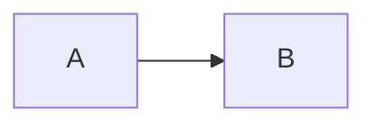

# `docmarq.md`

Markdown engine: markdown content written into a `DOCX`, after its last block.
Requires `pip install docmarq[md]`.

The engine writes content only.
The page around it - banner, header, footer, signing lines - belongs to a document package:

- [`docmarq.paper`](../paper/readme.md): documentation with a frontmatter banner, `md_to_docx` and `md_into`
- [`docmarq.legal`](../legal/readme.md): letters, statements, contracts, parallel versions, `md_to_docx` and `md_parallel_to_docx`

## Engine API

```py
from docmarq import DOCX
from docmarq.md import MarkdownRenderer, MarkdownStyle

doc = DOCX("out.docx")
renderer = MarkdownRenderer(doc, MarkdownStyle(), base_dir=".")
renderer.render(text) # parse + index + render_tokens, frontmatter dropped
doc.save()
```

`render()` writes a whole document at once.
A package that lays out the page itself works in steps:

- `renderer.parse(text)` returns tokens, frontmatter dropped
- `renderer.index(tokens)` registers the heading slugs `[text](#slug)` links resolve to, once per document before any part is written;
  `index(tokens, prefix="v2-")` keeps the bookmarks of one of several documents in a file apart from those of the others
- `renderer.render_tokens(tokens[a:b])` writes any slice after the last block
- `renderer.render_tokens(part, style)` sets that part in a style of its own: font, size, leading, paragraph gap; heading slugs run on across parts
- `renderer.frontmatter_file(fm, key)` gives the file a frontmatter key names, warning when it is missing

Functions of `docmarq.md` go with them:

- `top_blocks(tokens)` gives `(start, end)` of each top-level block, a `<!-- group -->` counting as one
- `split_frontmatter(text)`, `metadata_from_frontmatter(fm)` and `docx_metadata(fm, overrides)` read frontmatter, which the engine itself never writes

The renderer sets up the document as its style asks: Word's heading styles, the body typography, hyphenation.
Content goes wherever the core writes: in `doc.columns(2)` it flows through the columns, inside `with doc.into(cell, width)` it fills a table cell, and tables and images fit that width.

## Flowing text

```py
MarkdownStyle(justify=True, hyphenate="pl", keep_together=True, h2_size=None)
```

- `justify` sets paragraphs, list items, quotes and notes flush to both edges.
  Their last line and a line a hard break ends stay left.
- `hyphenate` turns on Word's automatic hyphenation, in the language it names.
  Word splits words by the language of the text, so `pl` makes the document Polish.
  Headings, table cells and code keep their words whole.
  The `DOCX` the engine writes into uses mm, as the engine does, or the renderer refuses it.
- `keep_together=True` keeps each paragraph on one page, and a top-level list on one page with its items.
  `False`, the default, leaves page breaks to Word.
- A heading size of `None` follows `body_size`.
  The sizes, `head_mode` and the rules under `#` and `##` restyle Word's `Heading 1…6`, so the whole document follows.
  A `head_mode` without `Italic` leaves the slant Word gives a level, as to `Heading 4`.
- `head_gap_top` adds to the paragraph gap above a heading, `head_gap_bot` sets the gap below it, both in mm.
  Left at `None`, each level keeps its own gaps.
- An ordered list keeps its delimiter, `1.` or `1)`, and Word counts on from its first number.

The defaults - `justify=False`, `hyphenate=None`, `keep_together=False`, sizes 20/16/13/11 - give the classic documentation look.

## Internal links

Markdown anchor links work out of the box:

```md
See the [Notify characteristic](#bluetooth-low-energy) section.

## Bluetooth Low Energy
...
```

Each heading auto-registers a GitHub-style slug _(lowercase, spaces → hyphens, unicode preserved)_ as a Word bookmark.
Links to non-existent slugs render as plain text rather than as dangling hyperlinks.

## Local links

Paths without a scheme _(`[x](file.md)`, `[x](folder/doc)`, `[x](/absolute/path)`)_ render as text, not linked, by default.
Set `link_root` to make them real URLs:

```py
MarkdownStyle(
  link_root="https://docs.company.com",  # root to prepend
  link_base="projects/foo",              # subfolder this doc sits in
)
```

Resolution:
- `[x](file.md)` → `https://docs.company.com/projects/foo/file.md`
- `[x](/abs/path)` → `https://docs.company.com/abs/path` _(absolute ignores base)_

## Style

```py
MarkdownStyle(
  para_gap=3,             # mm between paragraphs
  h1_size=20, h2_size=16, h3_size=13, h4_size=11, h5_size=11, h6_size=11,
  h1_underline=True, h2_underline=True,
  head_color=(0.09, 0.11, 0.13), # Word's heading styles
  hr_thick=0.5,           # pt, rules and signing lines
  footnote_label=None,    # "References" puts an H2 above the footnotes
)
```

`lang_style("pl"|"de"|...)` builds a `MarkdownStyle` with the callout labels of a built-in preset _(`en`, `pl`, `de`, `fr`, `es`, `it`, `cs`, `sk`)_.
The document packages layer their own labels on top.

### Intentional divergences from pdfmarq

Same field names, deliberately different values - do not "fix" these:

| Field | pdfmarq | docmarq | Why |
| --- | --- | --- | --- |
| `line_height` | `1.4` | `1.0` | Word's "Single" already adds ~1.2× leading; pdfmarq has none |
| `font_body` / `font_mono` | `Vera` / `Courier` | `Calibri` / `Consolas` | embedded TTF vs font resolved on reader's machine |
| `keep_together` | `True` | `False` | pdfmarq measures each block; Word breaks pages itself, as docmarq always let it |
| `math_fontset` | `stixsans` | `stix` | fallback formulas blend with Word's serif Cambria Math |
| `mermaid_remote` | - | `True` | allow the mermaid.ink fallback; `False` keeps diagram source on the machine |
| `syntax_theme` | Pygments style name | _absent_ | docmarq has no syntax highlighting, so it has no dead field for it |
| `head_gap_top` / `head_gap_bot` | `3` / `1.5` mm | `None` | each Word heading level keeps its own gaps, as docmarq always set them |
| `hr_thick` | `0.3` pt | `0.5` pt | the rules docmarq always drew; Word keeps eighths of a point |
| `mark_bg`, `inline_image_max_h` | read | inert | DOCX keeps `==mark==` as text and an image in running text as its alt; the fields let a pdfmarq style carry over |

pdfmarq's style also holds fields for drawing details Word decides itself: `table_*`, `code_block_*`, `quote_*`, `list_indent`, `mono_size`, the `*_mode` faces and more.
docmarq has none of them, so a style that sets them stays with pdfmarq.
`MarkdownRenderer` takes `font_dir` in docmarq, for mermaid and SVG text; pdfmarq's `PDF` holds its own.

The `gutter` of `md_to_docx` is Word's native gutter, on the left of every page; pdfmarq folds it into the left margin.

## Features

````md
# Headings h1 through h6

**bold** *italic* ***bold italic*** ~~strike~~ `inline code`

- Unordered lists
  - Nested
1. Ordered lists

| GFM | tables |
| --- | -----: |
| A   |  right |

```py
# Fenced code (no syntax highlighting in DOCX, language is accepted but ignored)
def hello(): pass
```



> Blockquote with left border

> [!NOTE]
> GitHub-style callouts: NOTE / TIP / IMPORTANT / WARNING / CAUTION

Footnotes[^1] collect at the end of the document.
[^1]: Definition at end of doc.
````

Word handles pagination on open, so there's no analytical page-break pass.
Paragraphs and tables reflow naturally.

A table cell holds plain text: formatting flattens, and an image leaves its alt text.
Inline HTML tags are dropped and their text kept, and other raw HTML is dropped, so prefer `---` over `<hr>`.

An image over a `---` line is what CommonMark reads as a setext heading holding the picture.
`docmarq` keeps it a figure and draws the line as a rule, matching the author's intent.

## Mixing with core API

```py
from docmarq import DOCX, RichSegment
from docmarq.md import MarkdownRenderer, MarkdownStyle
from docmarq.parts import signatures
with DOCX("out.docx") as doc:
  # Hand-crafted cover page
  doc.font("Calibri", 28, "Bold").para("Title", align="C")
  doc.font(size=11, mode="Regular")
  doc.page_break()
  # Markdown body
  MarkdownRenderer(doc, MarkdownStyle()).render(open("body.md").read())
  # Signing lines
  label = RichSegment("", size=9, color=(0.4, 0.4, 0.4), italic=True)
  signatures(doc, ["Signature"], label, gap=20, width=70, thick=0.5)
```

A cover followed by a paper document, banner, page number and signing lines included, goes through [`docmarq.paper.md_into`](../paper/readme.md#md_into).

## Math formulas

Inline `$...$` and display `$$...$$` (also ` ```math ` fences) render as **native Word equations (OMML)**: editable in Word's equation editor, selectable, and scaling with font and zoom.
The converter is self-contained, built straight on OOXML with no extra runtime dependency, and covers the common markdown-math subset:

````md
Inline $E = mc^2$ and the quadratic root $x = \frac{-b \pm \sqrt{b^2-4ac}}{2a}$.

$$\sum_{i=1}^{n} i = \frac{n(n+1)}{2}$$

$$f(x) = \begin{cases} 1 & x > 0 \\ 0 & x \le 0 \end{cases}$$
````

Supported:

- superscripts and subscripts, `\frac` / `\dfrac` / `\tfrac` / `\binom`, `\sqrt` and `\sqrt[n]`
- big operators (`\sum`, `\prod`, `\int`, `\oint`, ...) with limits
- Greek, relation, operator, arrow and set symbols, functions (`\sin`, `\log`, `\lim_{...}`, ...)
- delimiters (`\left ... \right`), accents (`\hat`, `\vec`, `\bar`, `\dot`, ...), `\overline` / `\underline`
- matrices (`matrix` / `pmatrix` / `bmatrix` / `vmatrix` / `cases`)
- font commands (`\mathbb`, `\mathcal`, `\mathbf`, `\mathrm`, `\text`, ...)

LaTeX outside this subset falls back to a **matplotlib-rendered image**, so the formula still appears and raw `$...$` never does.
Inline fallback images are baseline-aligned.
A `\tag{...}` becomes the right-aligned equation label, Word style.

```py
MarkdownStyle(
  math_enable=True,     # False leaves `$...$` as plain text
  math_fontset="stix",  # fallback image fontset (matplotlib mathtext)
)
```

The image fallback needs matplotlib (`pip install docmarq[math]`).
Without it, unconvertible formulas degrade to their LaTeX source as inline code.

## Not supported (use `pdfmarq` if you need them)

- Syntax highlighting in fenced code _(language hint is accepted, ignored)_
- Task lists, `==mark==`, `^sup^`, `~sub~`, emoji shortcodes and definition lists, which stay literal text
- Rich inline content inside table cells _(math in a cell degrades to `$latex$` source text)_
- Clickable footnote references: `[^1]` prints a superscript `[1]`, and the definitions collect at the end

## Optional deps for features

Installed by `pip install docmarq[md]`:
- `markdown-it-py`, `mdit-py-plugins`: parser + GFM plugins
- `PyYAML`: frontmatter

System tool via npm, **not on PyPI**:
- `mermaid-cli` for ` ```mermaid ` blocks: `npm install -g @mermaid-js/mermaid-cli`.
  Without it diagram source goes to the `mermaid.ink` HTTP service, which warns once per process.
  `mermaid_remote=False` keeps it offline and renders a code block instead.

If a dep is missing, the feature degrades and says so _(a mermaid block renders as a regular code block)_.
